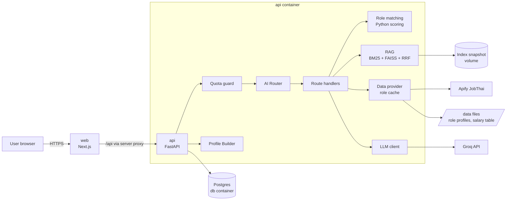
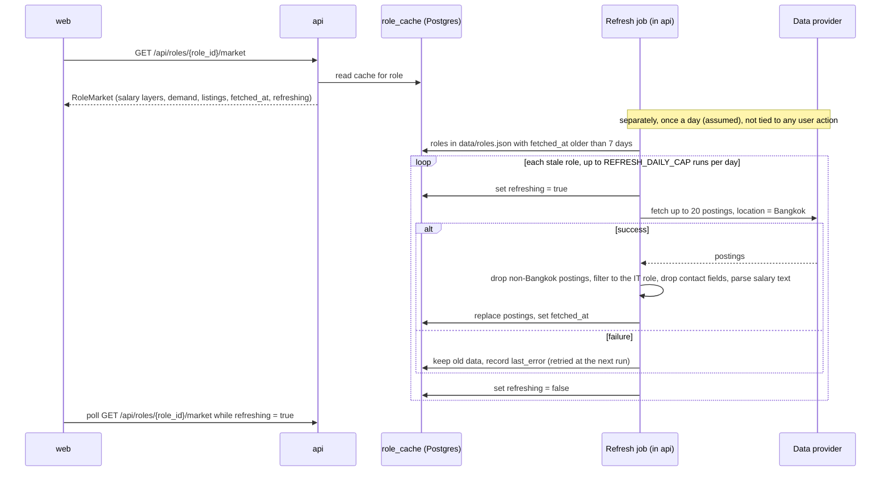

# CareerMirror: Design

<!--
PURPOSE: Architecture and flow only. How the system is put together and how data moves through it.
This file also replaces a separate architecture.md (they would duplicate each other).
DOES NOT CONTAIN: requirements (see PRD.md), UI rules (see DesignSystem.md), colours, fonts (see CIBrand.md),
endpoint shapes (see Contract.md), dates (see Schedule.md). Link to those; do not copy them.
OWNER: backend lead. Update when a component or data flow changes.
-->

Scope and requirements: [PRD.md](PRD.md) · Endpoints: [Contract.md](Contract.md) · UI: [DesignSystem.md](DesignSystem.md)

Status: agreed 1 Nov 2026. Thresholds and scoring weights are decided and are re-checked in the 3 Nov calibration (section 10). The few items still marked (assumed) are not confirmed yet.

## 1. System overview



Three containers: `web`, `api` and `db` (Postgres). Everything else runs inside `api`. The vector index is the hybrid retrieval from Team-D-II module 05 (BM25 + FAISS + Reciprocal Rank Fusion), stored in SQLite with an in-memory snapshot, so no separate vector-DB container is needed. Numbers (match %, completeness %, salary figures) are always computed or looked up in Python; the LLM only writes explanations (PRD FR-18a).

## 2. Components

| component | responsibility | inputs | outputs |
|---|---|---|---|
| **Web** (Next.js App Router, JavaScript) | Thai UI in light and dark theme (choice kept in the browser only, PRD FR-36 to FR-39), consent, CV upload, questionnaire, chat with completeness sidebar, profile, role results, role view | user actions | calls to `/api/*` through the Next.js server proxy (the auth cookie never leaves the server side) |
| **API** (FastAPI) | trust boundary: auth, validation, quota, persistence, orchestration | HTTP requests | JSON per [Contract.md](Contract.md) |
| **Auth** | email + password register/login; JWT (HS256) in an httpOnly cookie | credentials | `user_id` for every request |
| **Quota guard** | per-user daily request and token limit, checked before any LLM call (FR-23, FR-24) | `user_id`, estimated tokens | allow, or `429 QUOTA_EXCEEDED` with reset time |
| **CV parser** | PDF → text → structured fields (skills, education, experience) (FR-1–FR-4) | PDF ≤ 5 MB | draft `CvParsed` for the user to confirm; lines under a projects heading are not part of it, and go to the LLM as facts when the profile is generated |
| **Profile Builder** | completeness meter (FR-9, FR-14), "Generate profile" (FR-15–FR-17), profile edits (FR-27–FR-34) | CV, answers, chat facts | `Profile` with evidence per claim |
| **AI Router** | picks exactly one route per chat message (FR-11), logs the decision (FR-13) | message + short context | `route`, `confidence`, `layer` |
| **Role matching** | match % per role, matched / missing skills, threshold, top N, gaps (FR-18–FR-20a) | profile, role profiles | `RoleMatch[]` |
| **RAG** | hybrid search over role descriptions, learning paths, soft-skill and work-style notes | query, filters | chunks with source ids |
| **Data provider** | job postings, advertised salaries, demand per role behind one interface; per-role cache, Bangkok only, refreshed by a scheduled job (FR-21–FR-22f) | `role_id` | `RoleMarket` with `fetched_at` |
| **LLM client** | Groq chat completions, model per task from env (section 4.7), retry with backoff, fallback model on 429/413, token counting | prompt | text or structured JSON, tokens used |
| **Admin** | read-only monitoring for `ADMIN_EMAILS` accounts (PRD FR-40 – FR-46): health, LLM usage, quota, job-data cache, router, funnel | admin `user_id` | aggregates from the tables in section 5, never user content |
| **Request and LLM logging** | middleware writes one `request_log` row per API request; the LLM client writes one `llm_calls` row per Groq call (every task, not only chat) | request, LLM call | rows for the admin dashboard |
| **Storage** | Postgres in the `db` container (app data); SQLite file on the `api` volume (RAG retrieval store only) | – | – |

Reused code (read before writing new): Team-D-II `services/02_api_backend` (app factory, Problem-JSON errors, request-id middleware, body guard, rate limit, JWT cookie auth, Alembic) and `services/05_retrieval_knowledge` (SQLite store, chunking, hybrid search, snapshot swap). Retrieval moves from its own service into `api/app/rag/`.

### 2.1 API code layout

```
api/app/
  main.py               app factory, lifespan (open DB, load index snapshot)
  core/                 config, errors (Problem-JSON), logging, security (JWT, password hash)
  api/routes/           auth, me, cv, questionnaire, chat, profile, roles, quota, admin
  services/             use cases: profile_service, chat_service, quota_service, profile_edit_service, admin_service
  domain/               pure Python, no FastAPI or DB imports
    matching/           skills.py (taxonomy + aliases) · scoring.py · models.py
    completeness.py · evidence.py · edits.py
  router/               guards, rules, LLM decision, route handlers, prompts
  rag/                  store, chunking, tokenize (pythainlp), embedder, snapshot, hybrid
  providers/            data provider interface, apify_jobthai, reference_table, nso
  infra/                db session + models, migrations glue, llm client
api/tests/              mirrors app/
```

`domain/` stays framework-free so scoring and edit validation are unit-tested without a server.

## 3. Request flow (chat message)

1. `web` sends the message to `POST /api/chat` with the auth cookie.
2. `api` authenticates, validates the body, assigns `request_id`.
3. **Quota guard**: if the user's requests or tokens for today are used up → `429 QUOTA_EXCEEDED`; no LLM call (FR-24).
4. **AI Router** decides the route (section 4.6). Rules and guards cost no tokens; the LLM layer counts toward quota.
5. The route handler fetches only what it needs: profile slices, scoring results, RAG chunks, cached market data (FR-12).
6. The LLM writes the answer from that context. Numbers in the answer must match the computed values; a check rejects mismatches and falls back to a template. If the LLM fails while wording `skill_assessment`, `blind_spots` or `job_matching`, the same template answers. The last 4 messages, each cut to 300 characters, go with the router and answer calls so a short follow-up can be read; they are not a source of facts.
7. `api` records tokens used, logs `request_id`, route, layer, latency and tokens (never CV text), stores the chat message.
8. Response returns the answer, cited sources, any profile-edit proposal, and quota headers.

## 4. Main flows

### 4.1 Intake: CV, questionnaire, chat, completeness

```mermaid
sequenceDiagram
  participant W as web
  participant A as api
  participant DB as Postgres
  W->>A: POST /api/cv (PDF)
  A->>A: check type and size, extract text (pypdf / pdfplumber)
  alt no text layer (scanned)
    A-->>W: 422 CV_UNREADABLE (Thai message)
  else text found
    A->>A: extract skills, education, experience (rules + skill taxonomy; plus LLM extraction if quota is left, counted toward quota; rules only otherwise)
    A->>DB: save draft (status = draft)
    A-->>W: CvParsed draft
    W->>A: PUT /api/cv/confirm (user-corrected fields)
    A->>DB: save confirmed fields, recompute completeness
  end
  W->>A: PUT /api/questionnaire/answers/{question_id}
  A->>DB: upsert answer (resume later, FR-6)
  W->>A: POST /api/chat (follow-up answers)
  A->>DB: store extracted facts with evidence
  W->>A: GET /api/profile/completeness
  A-->>W: score 0-100, missing slots, can_generate
```

The raw PDF is not stored; only the extracted text (needed as evidence lines) and the confirmed fields. CV text is never written to logs.

**Completeness meter** (decided 1 Nov 2026, PRD open question 3; weights and threshold calibrated on 3 Nov). Slot weights follow what the outputs use: hard skills with levels drive 85% of the match % (section 4.3) and all next steps, so they weigh most and are required; goals and education are not used in scoring.

| slot | points | required | filled by |
|---|---|---|---|
| hard skills (≥ 3, each with a level) | 35 | yes | CV, questionnaire checklist or chat |
| experience entries, or "no experience" stated | 15 | yes | CV, chat, or questionnaire (`ex_it_experience` = `none` only) |
| soft skills (≥ 3 with an example) | 15 | no | questionnaire or chat |
| goals: interested roles, desired salary, location | 15 | no | questionnaire or chat |
| work-style preferences | 10 | no | questionnaire or chat |
| education | 10 | no | CV, questionnaire or chat |

```
can_generate = (CV confirmed or questionnaire answered)
               and every required slot is filled
               and score ≥ COMPLETENESS_THRESHOLD (65)
```

- 65 = the two required slots (50) plus at least one more slot.
- From chat (decided 4 Nov 2026): a level counts only when the user's own message gives it, as a digit or Thai digit, or in words ("พื้นฐาน" 1, "พอใช้" 2, "เก่ง" 3, "เชี่ยวชาญ" 4). A number that counts something, as in "ใช้ Docker มา 3 ปี", is not a level. Only a skill the taxonomy can place fills the hard-skills slot, because a skill outside it scores nothing; skill names may be transliterated or mistyped ("ไพท่อน", "Pyhton"). "No experience" is accepted only from a message about experience, or an answer to that question, so "ยังไม่มีทักษะ" does not fill that slot.
- What chat asks next: required slots first, and they stay until filled. An optional question is dropped once asked twice, or when the user says to skip it or does not know. The reply says when the profile can be generated, and when only a CV or questionnaire is missing, as soon as that is true, with any other question after it as optional.
- From the questionnaire (decided 2 Nov 2026): any other `ex_it_experience` answer leaves the experience slot empty, so chat asks for the entries. Soft skills need at least 3 `ss_*` answers of 4 or 5 plus an answer to `ss_example`. Work style needs all six trait questions. Goals need any one goal question. The same skill from the CV and the checklist counts once.
- Skill level for CV users comes from rules (years, project count). When the CV gives neither, chat asks the user for a self-rating (1-4, the skill levels in section 6). The questionnaire checklist already asks for a level.
- `gap_question` asks about missing required slots first, then the slot with the most points. The question text is fixed in Python; the LLM only extracts facts from the answer, and Python checks them: a skill must be in the message or in the question it answers, and a level must be a number the user wrote.
- Expected chat turns before generation: questionnaire-only student 1 (experience), CV-only developer 1 (soft skills or goals), CV + questionnaire 0.

### 4.2 Generate profile

```mermaid
sequenceDiagram
  participant W as web
  participant A as api
  participant L as Groq
  W->>A: POST /api/profile/generate
  A->>A: can_generate? quota check
  A->>A: build facts list with evidence ids (CV lines, answers, chat statements)
  A->>A: map free-text skills to taxonomy (aliases only); the rest stay as the user's own words
  A->>L: write experience summary and blind spots from facts only (structured JSON, each claim lists evidence ids)
  L-->>A: draft sections
  A->>A: drop claims without valid evidence ids or with numbers not in the facts; drop experience claims naming skills not in the facts; drop removed skills
  A->>A: save Profile, run role matching (4.3)
  A-->>W: Profile + RoleMatch summary
```

Profile sections: hard skills, soft skills, work-style preferences (shown as self-reported, FR-17), experience summary, blind spots. Skill levels come from rules (years, project count, self-rating), not from the LLM.

- Python writes the hard and soft skill lists, the work-style section, total months and preferences. The LLM writes only the experience summary and blind spots. If no experience claim survives the checks, the summary is the plain list of entries.
- Level order: CV rule, then questionnaire self-rating, then the latest level given in chat. A hard skill with no level from any source is shown as level 1, the lowest claim; `can_generate` already needs 3 rated skills.
- Free-text skills are not mapped by embedding similarity. Tested 2 Nov 2026 with `multilingual-e5-base` on 25 terms: unrelated text ("ทำอาหาร" 0.83, "ขับรถ" 0.83) scored as high as correct pairs ("ReactJS" to React 0.84), so no threshold separates them, and a wrong mapping would inflate the match %. They stay as custom skills that show on the profile and do not count in role scoring.
- Deleting the CV deletes a profile that quotes CV lines as evidence, and the user generates it again. A profile built only from the questionnaire and chat stays.
- Confirming the CV works out `months` from the dates when a start date is given, because the review form edits only the dates.
- A skill typed by hand is mapped to the taxonomy when its text names exactly one skill, so it scores like that skill. A duplicate in the CV keeps the higher level.
- Emails, links and phone numbers are removed before the parser reads skills, jobs and schools, and from any fact sent to the LLM.

### 4.3 Role matching, threshold, next steps

For each of the 26 role profiles in `/data/roles/`:

```
hard_required = Σ w·min(user_level / min_level, 1) / Σ w      # missing skill = 0; any_of group = user's best level in the group
hard_nice     = share of nice-to-have hard skills the user has
soft          = share of the role's soft skills present in the profile
work_style    = 1 − mean distance between user preferences and role traits (0..1)

match_pct = round(100 × (0.70·hard_required + 0.15·hard_nice + 0.10·soft + 0.05·work_style))
```

Weights decided 1 Nov 2026 and re-checked in the 3 Nov calibration (section 10).

- Removed skills are excluded (FR-31). Skills are compared by taxonomy id after alias normalisation (Thai and English names).
- With no work-style answers, `work_style` is a neutral 0.5; with some, the mean uses only the traits answered. `match_pct` rounds half up.
- Matches are computed from the saved profile on each read and are not stored.
- Show roles with `match_pct ≥ MATCH_THRESHOLD` (60), top `TOP_N_ROLES` = 5 (FR-19, FR-20). The threshold is re-checked with three sample profiles (student, full-stack developer, ML developer) on 3 Nov.
- None pass → return the 3 closest roles with `below_threshold = true` and their missing skills (FR-19a).
- **Gaps** per role = missing required skills (sorted by weight) + below-level skills + missing soft skills. Each gap has an id.
- **Next steps** (FR-20a): the LLM receives the first 5 gaps, that role's learning-path chunk and notes on its missing soft skills, both from RAG, and writes one action per gap. Until the index is ready, the path comes from the role file and there are no notes. Priority is the gap order from scoring, not the LLM's. An action with no valid gap id, or with a skill or number not in the facts, is replaced by computed text, so every shown gap keeps a step.
- **Wording is stored** in `match_explanations` with a hash of the role's gaps and matched skills. `POST /api/profile/generate` words the shown roles under its one request; if that call fails, the profile is still saved. A role with no stored wording shows computed text. A shown role whose hash no longer fits is `explanations_stale` until `POST /api/roles/matches/explain`, which costs nothing when there is nothing to rewrite. A role outside the list shows computed text instead of going stale, because that endpoint does not rewrite it.
- Match reasons cite evidence ids for matched skills (FR-16, FR-19).
- `parse_claims` cuts a copied `evidence_ids` field out of a sentence and drops a sentence that still shows an id, so ids reach the user only as citation numbers.
- Matching never triggers a fetch. Role views read the shared per-role cache (FR-22b, 4.4).

### 4.4 Role view: cache read, scheduled refresh, fallback



- Reading a role view always uses the cache and never calls the provider (FR-22b). User actions (matching, opening a role, editing the profile) never trigger a fetch.
- The cache is one copy per role, shared by all users (FR-22a).
- Seed run before the demo: one fetch per role, stored as the baseline in the `db-data` volume, not in git (FR-22a).
- Refresh rules (FR-22b, FR-22c, FR-22f):
  - every seeded role in `data/roles.json` (currently 26) is refreshed when its cache is older than `CACHE_MAX_AGE_DAYS` (7) or its last fetch failed. A role that was never seeded is left to the seed, so an empty database does not spend credit by itself (assumed);
  - each run asks for up to 20 postings with the Bangkok location filter, so a full cycle is 26 runs and about 520 results per week;
  - `REFRESH_DAILY_CAP` (20) and `APIFY_WEEKLY_BUDGET` (26, Monday to Sunday) limit provider runs. Both count `refresh_log`, so a restart does not reset them. Roles left over run at a later check (assumed);
  - roles run oldest first, and a role whose last fetch failed runs after the others, so one that keeps failing does not use up the budget (assumed);
  - the job runs inside `api`, started from the app lifespan. It checks at start-up and then every 24 hours. Because `api` has one worker, only one copy of the job runs (assumed). The job does not coordinate with `seed_market`, so do not run the seed while roles are due;
  - with no `APIFY_TOKEN` the job does not run, and roles keep their data with no error;
  - start-up clears any `refreshing` flag left by an api that stopped during a fetch (FR-22d).
- On failure the view shows the previous cached data with its date (FR-22b, NFR reliability). `refreshing` is true only while that role is being fetched, so the loading state is shown only then (FR-22d).

### 4.5 Profile edit (chat edit and remove button)

```mermaid
sequenceDiagram
  participant W as web
  participant A as api
  participant L as Groq
  W->>A: POST /api/chat "เปลี่ยนสายงานที่อยากได้เป็น Data Engineer"
  A->>A: quota check, router → profile_edit
  A->>L: extract structured change (field, op, new value)
  L-->>A: change
  A->>A: validate against allow-list; fill old value from stored profile
  A-->>W: proposal (Thai text of the exact change) + edit_id
  W->>A: POST /api/profile/edits/{edit_id}/confirm
  A->>A: apply, label edited_by_user, evidence kind = user_action
  A->>A: recompute matching (role views re-read the cache, no fetch)
  A-->>W: updated Profile + RoleMatch
  Note over W,A: Remove button: DELETE /api/profile/skills/{skill_id}<br/>no LLM, no quota; adds skill to removed list; recompute
```

- Skill removal asks for confirmation in the UI before `DELETE` is sent (FR-29, PRD open question 7); there is no undo toast. Restore is from the removed list.
- The LLM never writes to the profile (FR-28). Confirm, reject, remove and restore cost no quota and work when quota is exhausted (FR-30, FR-34).
- A removed skill is not re-added from the CV or chat; a chat request to add it back produces a proposal flagged `restores_removed_skill` that the user confirms (FR-31).
- The extraction call uses the router model. The API drops anything off the allow-list, a level outside 1–4, a role not in the catalogue, and a change that changes nothing. If nothing is left, the reply says so and no proposal is saved. The reply states the change itself, and names what could not be done and why (a level outside 1–4, a role not in the catalogue, a skill or place not in the profile). The call also gets the current roles, locations and desired salary, so "เพิ่มอีก 5000" can be worked out.
- Chat adds only skills in the taxonomy, because a custom skill does not count in role scoring. A name that is not found gets the closest skill as a proposal, with "คุณอาจหมายถึง ... หรือไม่" in the reply, and the user confirms or rejects it on the card. With no close skill, the reply says so and nothing is proposed. A custom skill already in the profile can still be changed or removed.
- A new proposal closes any waiting proposal for the same field (status `rejected`) and the reply says so, so an old card cannot undo a newer one: confirming it gives `EDIT_NOT_FOUND`. Typing "ยืนยัน" changes nothing; the reply points to the button, because only the button confirms (FR-28).
- Confirming compares each change's old value with the saved profile; a difference is `EDIT_CONFLICT`. A message that both removes and changes a skill proposes only the removal.
- `removed_skills` keeps the whole skill, so a restore brings back its level and evidence. Adding it back by chat with no level stated uses the same stored level.
- Generating the profile again keeps what the user edited: edited skills, edited preferences, and `user_action` evidence. Removed skills stay out, also when removed during generating, and a summary, project line or example that names one is not sent to the LLM. A job title still is. Edited preferences are stored in `profiles.sections` as `edited_preferences`, which the API never returns.
- Removing a skill does not rewrite the experience summary or blind spots, which were worded earlier. They can still name that skill until the profile is generated again.

### 4.6 AI Router

Layers, reused from Team-D-II module 03:

1. **Guards** (no LLM): empty or too long input, prompt-injection markers, off-topic patterns → `decline`. "system prompt" or "คำสั่งระบบ" is refused only with a request to see it, because a career question can name them.
2. **Small talk and keyword rules** (no LLM): greetings, thanks, "ทำอะไรได้บ้าง", typed confirmation and similar → `small_talk`; Thai and English patterns per route, confidence 0.9. A keyword does not decide when the message asks something else about that topic ("สาย backend ต้องมีประสบการณ์กี่ปี") or says "ไม่ได้ถาม…"; those go to the LLM. A route keyword with words of change ("เปลี่ยนเป็น", "ผิด", "ขอเป็น") in a statement → `profile_edit`.
3. **LLM decision** (Groq, structured output, counts toward quota) when rules do not match. It sees the recent turns (section 3).
4. Low confidence (< 0.6, assumed) → `clarify`. A message that names a role is asked which topic of that role.

| route | fetches | LLM writes |
|---|---|---|
| `skill_assessment` | profile skill names, levels and evidence ids | assessment claims, checked by `parse_claims`; computed skill list if none hold up |
| `work_style` | saved `Profile.work_style` + 2 RAG `work_style` notes, or the one aspect Jev picks and its note (§4.7) | nothing: the saved self-reported summary (or the user's choice for the asked aspect), what the notes say it means at work with their citation, and the FR-17 disclaimer |
| `blind_spots` | saved blind spots + gaps for the top 3 roles + 2 RAG `soft_skill` notes on missing soft skills | blind-spot claims, checked by `parse_claims`; saved text and computed gaps if none hold up |
| `job_matching` | `RoleMatch[]` (computed), or the role asked about scored the same way, + the RAG `learning_path` chunk of that role | reasons, checked by `parse_claims`; percentages and skills to add come from Python |
| `salary` | `data/salary/reference.csv` (role from message, else from the previous turn on a follow-up, else an interested role, else the best match) | nothing: range, measure, source and date come from the table |
| `market` | the cached `RoleMarket` (role chosen as for `salary`) | nothing: count, skills, advertised range, source and date come from the cache; the count is labelled a capped sample |
| `experience` | saved experience summary and months | nothing: the summary was worded when the profile was generated |
| `profile_edit` | the targeted field only | structured change (4.5) |
| `small_talk` | waiting proposals, for a typed confirmation | nothing: fixed Thai text, no tokens; counts as one request |
| `clarify` / `decline` | – | one short question / refusal |
| `gap_question` | missing completeness slots | facts from the answer (the next question is fixed text) |

When a question names a role, that role's required skills against the user's levels go to the LLM, and whether each is enough is computed in Python, so the role need not be in the top matches. On top of `parse_claims`, chat answers drop a claim that uses a Latin-letter name not among the fact values (a tool, certificate or company, or a field name such as `required_level`), or that advises learning a skill the shown roles are already satisfied with and names no gap. Thai text cannot be checked this way.

RAG only adds to an answer. The model loads in a background thread at start-up, so the api is healthy at once, and until the index is ready, or if it fails, those routes answer from their other data. A cited draft note says it has not been reviewed.

Before a profile exists, `salary` and `market` questions caught by the keyword rules are answered, because they use only cached role data; a statement such as a desired salary is an answer to a follow-up question, not a question. Every other message that passes the guards routes to `gap_question`, with no LLM decision: chat asks follow-up questions driven by the missing completeness slots (FR-8), and the user's answers become facts with chat evidence. Small talk there skips the fact extraction and gets its reply ahead of the next question. A message that hits two routes, such as salary and experience, also stays `gap_question`, even if it asks about pay, because no LLM decides here. A Thai router evaluation set (about 40 cases, like `eval_routes.py` in Team-D-II) is kept in `api/tests/router/routing_cases.jsonl` and its accuracy goes into the report (`eval_routes.py` in the same folder runs it against Groq). A message that hits two routes in the keyword rules goes to the LLM layer. An LLM routing call used about 260 tokens in that run.

#### Router evaluation

`api/tests/router/eval_routes.py`, run 4 Nov 2026 with `qwen/qwen3.8-27b`, as a user who has a profile. Each held-out set was written before its first run and is used for measuring only. Once a set has led to a fix it stops being held out, so a new one is written.

| set | when | correct | guards | rules | LLM |
|---|---|---|---|---|---|
| held out, first set (`routing_heldout_v1.jsonl`) | before the rule fix | 31 / 34 (91%) | 1 / 1 | 4 / 7 | 26 / 26 |
| held out, second set (`routing_heldout.jsonl`) | after the rule fix | 33 / 34 (97%) | 1 / 1 | 6 / 7 | 26 / 26 |
| held out, third set (32 cases, kept with the test results) | after adding `small_talk`, on 5 Nov, through the API with chat history | 29 / 32 (91%) | – | – | – |

- The two figures use different cases and each set is small, so they do not show a 6-point gain. What the fix shows directly is that the first set's three errors are gone, with no new errors on the 47 tuned cases (`routing_cases.jsonl`). Their 100% is not an estimate of real use, because the rules and prompt were adjusted on them.
- The cases were written by someone who knows the rules, and the second set was written after seeing the fix, so these figures may be higher than real use.
- After `small_talk` was added, the second set gives 32 / 34 and the tuned set 46 / 47. The two errors are "โอเค" and "แล้วล่ะ", labelled `clarify`, which now get `small_talk`; the labels were left as they were. The tuned miss is one Groq timeout. In the third set, "ตอนนี้อยากได้เงินเดือน 42000" went to `salary` and was then fixed, so that set is no longer held out; "อันนั้นอะ" and "ยังไงดี" get `small_talk` instead of `clarify` and were left.
- Before that, the remaining error was left unfixed so the figure stayed a measurement: "เงินเดือนที่อยากได้ขอเป็น 40000" goes to `salary` (want `profile_edit`). All errors so far come from the keyword rules at confidence 0.9, never from the LLM.
- Provider failures are counted apart from wrong routes. On 4 Nov about 380 LLM calls gave four `LLM_TIMEOUT` results (about 1%), in a process with no search index loaded. Calls normally take under 1 s, the same messages passed when repeated, and the cause is not known. Router-tier calls now retry after 7 s (4.7); a real timeout during the next run was a `ReadTimeout`, and the retry answered it. Running sets one after the other also drew 22 responses of 429 from Groq; the retries recovered and no route changed, but that run took about 55 s instead of about 8 s. About 10 profile edits in a row through the API drew 7 responses of 429 and took 5.5 to 7.8 s instead of 0.3 s. At about 700 tokens per edit, 8K tokens/min is about 10 edits a minute across all users, though the limit behind these responses was not confirmed.

### 4.7 LLM models and limits

Decided 1 Nov 2026 (PRD open question 2). Model IDs come from env, so they can change without code changes.

| task | env var | model |
|---|---|---|
| profile generation, match reasons, next steps (user-facing Thai text) | `GROQ_MODEL` | `openai/gpt-oss-120b` |
| router decision, profile-edit extraction, CV extraction, facts from chat answers | `GROQ_ROUTER_MODEL` | `qwen/qwen3.8-27b` |
| fallback when the main model returns 429 or 413 | `GROQ_FALLBACK_MODEL` | `qwen/qwen3.8-27b` |

Groq limits per model, from the official rate-limits page (Nov 2026; verify for our account at console.groq.com/settings/limits): 30 requests/min, 1,000 requests/day, 8,000 tokens/min, 200,000 tokens/day. Limits apply to the whole Groq account, so every API key on that account shares them.

Rules that follow from the limits:

- The binding limit is 8K tokens/min. Keep each prompt under about 5K tokens: top RAG chunks only, a CV summary instead of the full text.
- On 429, a server error or a network error: wait (`Retry-After`, or 1 s), retry once, then call `GROQ_FALLBACK_MODEL` once, then return a Thai error message. A `Retry-After` above 5 s skips the retry. On 413 or an unusable answer (empty, cut off at the token limit, invalid JSON): go straight to the fallback model. On 401 or 403: stop at once. `LLM_TIMEOUT_S` covers all attempts of one request together. On the main model a timeout ends the request, because a long answer can use all of that time. Router-tier calls (router decision, profile-edit extraction, facts from chat answers) are short and normally take under 1 s, so each attempt gets `LLM_ROUTER_ATTEMPT_TIMEOUT_S` (7 s), and a timeout is retried at once, then goes to the fallback model if it is a different one. Two attempts stay under the 15 s target. Each timeout logs which kind it was (connect, read or pool). Every attempt writes its own `llm_calls` row.
- Per-user quota (assumed until tested): `QUOTA_DAILY_REQUESTS=40`, `QUOTA_DAILY_TOKENS=40000`. One full run (about 10 chat turns at about 2K tokens plus about 15K tokens for profile and matches) fits, and about 5 users per day fit the 200K tokens/day of the main model.
- Use a separate Groq account for the demo so development and testing do not use up its daily budget.
- No second provider (for example Gemini) as a fallback for Groq in the MVP: it would need another key and client before 5 Nov. Jev (below) is a primary for one task, with Groq behind it, not a fallback for Groq.

**Jev in the router's LLM layer** (added 5 Nov 2026, off by default). When `JEV_ROUTER_ENABLED=true` and `TYPESAFE_API_KEY` is set, TypeSafe's Jev (`jev-latest`, a Choice question) picks the route first, and `GROQ_ROUTER_MODEL` decides whenever Jev would answer `clarify`. Guards, keyword rules and every Thai answer stay as they are.

- Why both: alone, Jev scored 55/62 against Groq's 61/62 on clear cases in the hard-message set, and six of its seven misses were `clarify`. Together they scored 43/43, the same as Groq alone, on a new set written before the run, and Jev settled 33 of those 43 without a Groq call. The gain is fewer Groq router calls; better routing is not shown.
- If Groq fails after Jev said `clarify`, the user gets `clarify`, not an error.

- It gets one attempt of `JEV_TIMEOUT_S` (3 s). Any failure (timeout, network, 429, other status, unusable answer) goes straight to the Groq router call, so the user sees no error. Each Jev call writes an `llm_calls` row with task `router_jev`.
- It sends only the message and recent turns, never the CV or profile. They go to TypeSafe in the US, whose policy says it does not train on input but gives no retention period for the API.
- A choice below `MIN_JEV_CONFIDENCE` (0.4, assumed) counts as `clarify`, so it goes to Groq. Jev's confidence is a different scale from the number Groq reports, and 0.6 turned right answers into `clarify` in the trial.
- Jev tokens do not count toward the per-user token quota, which tracks Groq's limits. The message still counts as one request. Price: $0.042 per million input tokens, output free.
- Noul evidence checks are not used: on 103 real Groq claims they dropped 4 of 18 unsupported claims and 9 of 78 supported ones at a fixed 0.7.

**Jev picks the work-style aspect** (added 6 Nov 2026, on with the same switch and key). On the `work_style` route, Jev answers one more Choice question: which of the six aspects the question is about, or `overall`. With one aspect, the answer leads with the user's own choice for it and that aspect's note. With `overall`, a confidence below 0.4 or any failure, the user gets the whole work style as before.

- Why: a user who asked "ฉันเหมาะกับการทำงานแบบเดี่ยวหรือเป็นทีม" got all six aspects. On 52 questions written by someone who had not seen the first set or the prompt, Jev picked the right aspect for 51, against 37 for the top search hit, which also split 6 of 10 whole-style questions into one aspect. Through the answer code, 78 of 78 one-aspect questions then opened on the asked aspect, against 0 before.
- It sends only the question. Each call writes an `llm_calls` row with task `work_style_jev`, which the dashboard counts as Jev. It adds one Jev call to each work-style answer, about 0.25 s.
- The one miss: a question about two aspects at once got one of them.

### 4.8 Admin dashboard

```mermaid
sequenceDiagram
  participant W as web /admin
  participant A as api
  participant DB as Postgres
  W->>A: GET /api/admin/overview?window=today
  A->>A: authenticate; email in ADMIN_EMAILS? else 403 FORBIDDEN
  A->>DB: aggregate request_log, llm_calls, quota_usage, router_log, role_cache, job_postings, refresh_log, user tables
  A-->>W: AdminOverview (counts, rates, per-role cache rows, warnings)
  Note over W: refresh button and auto-refresh every 60 s while the page is open
```

- `ADMIN_EMAILS` is a comma-separated list in `.env` (the two team members). The check runs on every `/api/admin/*` request; there is no admin flag in the database, so changing admins needs only an env change and a restart.
- Read-only (FR-41): admin endpoints only run `SELECT` queries, never call the provider or the LLM, and are not counted in quota.
- Aggregates only (FR-42): queries return counts, rates and per-role rows; no query selects CV text, chat text, answers or emails.
- LLM limits are counted per Asia/Bangkok day from `llm_calls`; Groq's own reset time may differ, so the dashboard is an early warning, not the exact Groq counter (assumed). Limits come from `GROQ_DAILY_TOKEN_LIMIT` and `GROQ_DAILY_REQUEST_LIMIT` (200,000 and 1,000, section 4.7).
- Warnings (FR-44) use `ADMIN_WARN_LLM_PCT` (80), `ADMIN_WARN_ERROR_PCT` (5) and the cache rules in 4.4 (older than `CACHE_MAX_AGE_DAYS`, or `last_error` set); Apify runs this week are compared with the weekly budget of 26 (FR-22c).
- p50 / p95 latency is computed from `llm_calls.latency_ms`; the error rate from `request_log.status` and `code`. `request_log` leaves out `/api/health` (the Compose healthcheck would flood it) and CORS preflights; paths that match no route are stored as `(unmatched)`.
- `request_log` and `llm_calls` keep `LOG_RETENTION_DAYS` (30, assumed). A task started from the app lifespan deletes older rows when the API starts and once a day after that.
- `/api/admin/overview` does not count its own requests in the health panel, because the page refreshes itself every 60 s and would hide what users do.
- A model used in two roles is one row in the LLM panel, named by its main use, because Groq's limits are per model. With the current settings the router and fallback share one row; `fallback_calls` still counts fallback use.
- The funnel's registered, input, profile and role-opened steps follow users who registered in the window. The CV unreadable rate, completeness and edit counts are events in the window. A pending proposal past its time counts as expired, and `avg_completeness_at_generate` comes from `profiles.completeness_at_generate`, so profiles generated before this column existed are left out.
- `top_removed_skills` lists taxonomy skills only, because any other name was typed by a user (FR-42). It counts skills still removed, so a restored skill drops out.
- Apify runs this week count from Monday (Asia/Bangkok) and are compared with `APIFY_WEEKLY_BUDGET` (26).

## 5. Data model

Postgres (decided 1 Nov 2026, PRD open question 6), managed with Alembic. All user tables key on `user_id` and are removed by `DELETE /api/me`. JSON columns use `JSONB`. Tests may still run on a temporary SQLite file, so models avoid Postgres-only features outside JSON.

| table | fields |
|---|---|
| `users` | id, email (unique), password_hash, display_name, consent_at, created_at |
| `cv_documents` | id, user_id, filename, text_lines (JSON list), parsed (JSON), status (draft / confirmed), created_at, confirmed_at |
| `answers` | user_id, question_id, value (JSON), updated_at |
| `chat_messages` | id, user_id, role (user / assistant), text, route, request_id, created_at |
| `facts` | id, user_id, kind (skill / experience / education / preference / soft_skill / goal), value (JSON), evidence_id, created_at |
| `evidence` | id, user_id, kind (cv_line / answer / chat / rag_chunk / user_action), ref, excerpt |
| `profiles` | user_id (PK), sections (JSON with claims and evidence ids), profile_version, completeness_at_generate, generated_at, updated_at |
| `match_explanations` | user_id + role_id (PK), basis (hash of the gaps and matched skills), reason_th, next_steps (JSON), updated_at |
| `removed_skills` | user_id, skill_id, skill (JSON), removed_at |
| `edit_proposals` | id, user_id, changes (JSON), summary_th, status (pending / applied / rejected / expired), created_at, expires_at |
| `quota_usage` | user_id, day (Asia/Bangkok), requests, tokens |
| `router_log` | request_id, user_id, route, layer, confidence, latency_ms, tokens, created_at (no message text) |
| `role_cache` | role_id (PK), fetched_at, refreshing, last_error, demand (JSON), salary_advertised (JSON) |
| `job_postings` | id, role_id, source, title, company, location, salary_text, salary_min, salary_max, salary_period, posted_at, url, fetched_at |
| `refresh_log` | day, role_id, status, created_at (counts runs for `REFRESH_DAILY_CAP`) |
| `request_log` | request_id, user_id (nullable), method, route (path template, e.g. `/api/roles/{role_id}`), status, code, latency_ms, created_at (no body, no query values) |
| `llm_calls` | id, request_id, user_id (nullable), task (route or `profile_generate`, `explain`, `cv_extract`, `edit_extract`), model, prompt_tokens, completion_tokens, latency_ms, outcome (`ok` / `rate_limited` / `too_large` / `timeout` / `error`), fallback_used, created_at (no prompt or answer text) |

The retrieval store (`chunks`, `meta`) stays a separate SQLite file owned by `api/app/rag/`, as in Team-D-II module 05: it is rebuilt from `/data` and loaded into memory, so it does not need Postgres.

## 6. Role profiles and RAG documents

Authored files in `/data` (labelled team-curated in the UI):

```
data/
  roles.json                  role list: id, Thai/English name, source files
  roles/<role_id>.json        structured role profile
  roles/<role_id>.md          prose description + learning path (RAG source)
  skills.json                 skill ids, type (hard / soft), category, Thai/English names, aliases, sources
  role-skills.draft.json      first draft of skills per role, used to write the role profiles
  questionnaire.json          question ids, type, options, which slot they fill, source_ids, sources block
  rag/work_style.md           what each work-style preference means at work (draft)
  rag/soft_skills.md          soft skills in IT roles with observable examples (draft)
  salary/reference.csv        role_id, min, max, measure, level, match, source, url, file, published_at, retrieved_at, note
                              (18 of 26 roles; sources and duplicate rules in salary/README.md)
```

**Questionnaire sources** (decided 1 Nov 2026, PRD open question 4). Items are written by the team, in Thai, as self-report questions. They are built on O*NET descriptor names and definitions; the O*NET questionnaires themselves are not used, because they ask workers to rate their job, not themselves.

| source_id | source | used for | license |
|---|---|---|---|
| `onet_work_styles` | O*NET OnLine, Browse by Work Styles, USDOL/ETA, <https://www.onetonline.org/find/descriptor/browse/1.D> (retrieved 1 Nov 2026) | the six work-style questions and the adaptability, collaboration, perseverance and attention-to-detail items | CC BY 4.0 |
| `onet_skills` | O*NET OnLine, Browse by Essential Skills <https://www.onetonline.org/find/descriptor/browse/2.A> and Transferable Skills <https://www.onetonline.org/find/descriptor/browse/2.B>, USDOL/ETA (retrieved 1 Nov 2026) | the communication, growth, prioritization, collaboration and analytical-thinking (from Critical Thinking) items | CC BY 4.0 |
| `team` | written by the team | skills checklist, experience, education, motivation, goals, the open example question | – |

Attribution (CC BY 4.0) is required in the report and on the questionnaire page: credit USDOL/ETA, link the licence, and state that the team modified the content and that USDOL/ETA has not endorsed it. The full text is in `sources[].attribution` of `data/questionnaire.json`.

The location question (`go_location`) offers Bangkok, regional, remote and any, but job and salary data are Bangkok only (PRD FR-22f). The answer is stored as a goal and shown in the profile; it does not filter roles, and the role view keeps its "Bangkok data" label.

Every item in `questionnaire.json` lists its `source_ids`; the file's `sources` block holds URL, license, retrieved date and attribution text. The questionnaire page shows the attribution in its footer (DesignSystem.md section 5). Answers map to role profiles through `trait` (work style) and `skill_id` (soft skills), described below.

Role list (decided 1 Nov 2026, PRD open question 5a): the 26 roles in `data/roles.json`, ids in kebab-case (`software-engineer`, `ai-engineer`, ...). Skill ids come from `data/skills.json`. Profiles were drafted from `data/role-skills.draft.json` and the files in `pdf/`. All 26 are `status: reviewed` since 3 Nov 2026, with sakda1306 as reviewer. The review covers `required` skills only; `nice_to_have` and `soft_skills` were not checked.

Role profile shape (`data/roles/<role_id>.json`):

```json
{
  "role_id": "backend-developer",
  "title_th": "นักพัฒนาแบ็กเอนด์",
  "title_en": "Backend Developer",
  "career_stage": "entry",
  "required": [
    {"any_of": ["python", "java", "nodejs", "php", "dotnet", "ruby"], "min_level": 2, "weight": 3,
     "basis": "source", "evidence": ["pdf/23-fullstack-developer-job-description.pdf"]},
    {"skill_id": "sql", "min_level": 2, "weight": 3, "basis": "common", "evidence": []}
  ],
  "nice_to_have": ["docker", "caching"],
  "soft_skills": ["problem-solving", "teamwork"],
  "work_style": {"teamwork": 0.6, "structure": 0.6, "ambiguity": 0.5, "pressure": 0.5, "innovation": 0.5, "leadership": 0.3},
  "author": "Phanlop Boonleua",
  "reviewer": "sakda1306",
  "status": "reviewed",
  "updated_at": "2026-11-03",
  "sources": [{"file": "pdf/23-...pdf", "url": "...", "language": "en"}]
}
```

- `any_of`: alternatives where knowing one is enough (for example one backend language); scored with the user's best level in the group.
- `weight`: 1-3. `min_level`: the level a junior hire needs (most are 2).
- `basis`: `source` when the skill is stated in the role's source files (listed in `evidence`), `common` when it is common practice but not in the sources yet; confirm `common` skills with Bangkok postings.
- `career_stage`: `entry`, `mid` (it-project-manager, it-consultant) or `senior` (data-architect). Used to tell a fresh graduate why a mid or senior role scores low.
- `work_style` keys are the `trait` values of the six work-style questions in `data/questionnaire.json` (O*NET Work Styles): `teamwork` (solo to always with the team), `structure` (own flexible approach to clear steps and standards), `ambiguity` (wants a clear brief to enjoys open problems), `pressure` (steady planned pace to urgent tight deadlines), `innovation` (proven methods to new methods and tools), `leadership` (own part to leading and coordinating). The role value is 0..1; a user answer of 1-5 becomes (answer − 1) / 4 before the distance is taken.
- `soft_skills` are ids from `data/skills.json`. Each soft-skill question in `data/questionnaire.json` carries a `skill_id` (adaptability → `adaptability`, collaboration → `teamwork`, communication → `communication`, growth → `self-motivation`, prioritization → `time-management`, perseverance → `problem-solving`, attention_to_detail → `attention-to-detail`, analytical_thinking → `analytical-thinking`). An answer of 4 or 5 adds that skill to the profile as self-reported, with the answer as evidence. These eight cover the soft skills most roles list; the rest (for example `organization`, `creativity`, `presentation`) come from the CV or chat.

Role Markdown (`data/roles/<role_id>.md`): front matter (role_id, author, reviewer, status), then `## Role description` (category `role_description`) and `## Learning path` (category `learning_path`), written in Thai, then `## Sources` (not indexed). The learning path lists the required skills in weight order with the target level, then one practice project.

Skill levels: 1 = basic, 2 = working, 3 = strong, 4 = expert.

**RAG indexing**: categories `role_description`, `learning_path`, `work_style`, `soft_skill`. Markdown is chunked at `## ` headings; each chunk keeps `doc_id`, `category`, `role_id` and source so citations point to a real chunk. Search is hybrid (BM25 with pythainlp tokenisation + FAISS over multilingual embeddings, fused with RRF k = 60) with a `role_id` / `category` filter. Embedding model (decided 1 Nov 2026): `intfloat/multilingual-e5-base` (`EMBED_MODEL`), with the `query: ` / `passage: ` prefixes it expects. It is about half the size of `BAAI/bge-m3` and fast enough on CPU in one worker, and the corpus is small (26 roles plus a few notes) with BM25 alongside. Check with a Thai golden set (about 20 questions, `api/tests/rag/golden_th.jsonl`): if hit@3 is below 0.8, switch to `BAAI/bge-m3`. Result on 3 Nov 2026 with 30 questions over the role files and both notes, searched with no filter: hybrid hit@1 0.70, hit@3 0.93; vector hit@3 0.90; BM25 hit@3 0.83, so the model stays. The notes are still `draft`, so this is re-run if they change. Embeddings are also used to map free-text skills to taxonomy ids when alias lookup fails (similarity threshold assumed 0.75); they never produce a match %.

## 7. External data and caching

```python
class JobDataProvider(Protocol):
    name: str
    async def fetch_postings(self, keyword: str, limit: int) -> list[Posting]: ...
```

| source | layer | used for | notes |
|---|---|---|---|
| Apify JobThai scraper (`jobTypes` = 7 Computer/IT, location Bangkok, `includeDetails` on, `includeContacts` off) | advertised | postings, salary text, demand count, trending skills | unofficial; free plan 20 jobs per run; pay per result; the only job source (PRD open question 5); site terms not reviewed (accepted risk) |
| `data/salary/reference.csv` | reference | curated entry/junior monthly ranges per role from three 2026 Thai articles (Jobsdb, X10, SPU), with source and date; roles without a row return `reference: null` | team-curated |
| NSO / data.go.th IT-industry wage | sanity check | one baseline figure by industry | not by job title; no figure is in `/data` yet, so `salary.baseline` is `null` |

- Ingest drops postings whose location is not Bangkok (FR-22f) and drops contact fields (FR-22e). A posting fits the role when its title has a term from `data/role_search.json`, or when its title names no other role and it asks for at least 3 of the role's required skills from `data/skills.json`. The description is read for skills and not stored. Postings of every level stay in the cache; the level (intern, junior, senior, lead, manager, or none stated) is read from the title.
- Salary text is parsed into min, max and period (`month` / `year`); unparseable salaries and ceilings such as "ไม่เกิน 45,000" are kept as text only and excluded from ranges. The advertised range is the median low and the median high of the monthly figures.
- A run that returns nothing counts as a failure and keeps the previous data, because a broken scraper looks the same (FR-22b).
- Seed with `python -m scripts.seed_market --all` inside the `api` container. It skips roles fetched within `CACHE_MAX_AGE_DAYS`, and `--dry-run` shows the roles and the cost without a call.
- **Demand** = posting count in the last fetch, plus the top skills by frequency in descriptions.
- Two salary layers are always returned separately, each with source, measure and date (FR-21). No single "true" salary figure.

## 8. Deployment

`docker compose up --build` starts:

| service | image | port | volumes |
|---|---|---|---|
| `web` | `web/Dockerfile` (Node 20, Next.js standalone) | 3000 (host) | – |
| `api` | `api/Dockerfile` (Python 3.12, uvicorn, **one worker** because the search index lives in memory) | 8000 (internal; host only in dev) | `api-data:/app/var` (RAG SQLite file, index snapshot, embedding model cache) |
| `db` | `postgres:16-alpine`, healthcheck with `pg_isready`; `api` starts after it is healthy and runs `alembic upgrade head` | 5432 (internal only) | `db-data:/var/lib/postgresql/data` |

`/data` is mounted read-only into `api`.

Environment variables (names only; values live in `.env`, only `.env.example` is committed):
`APP_NAME`, `JWT_SECRET`, `JWT_TTL_HOURS`, `DATABASE_URL` (`postgresql+asyncpg://...@db:5432/careermirror`), `POSTGRES_USER`, `POSTGRES_PASSWORD`, `POSTGRES_DB`, `RAG_DB_PATH`, `EMBED_MODEL`, `GROQ_API_KEY`, `GROQ_MODEL`, `GROQ_ROUTER_MODEL`, `GROQ_FALLBACK_MODEL`, `LLM_TIMEOUT_S`, `LLM_ROUTER_ATTEMPT_TIMEOUT_S`, `QUOTA_DAILY_REQUESTS`, `QUOTA_DAILY_TOKENS`, `QUOTA_TZ`, `COMPLETENESS_THRESHOLD`, `MATCH_THRESHOLD`, `TOP_N_ROLES`, `CACHE_MAX_AGE_DAYS`, `REFRESH_DAILY_CAP`, `APIFY_TOKEN`, `APIFY_JOBTHAI_ACTOR`, `CORS_ALLOWED_ORIGINS`, `ADMIN_EMAILS`, `ADMIN_WARN_LLM_PCT`, `ADMIN_WARN_ERROR_PCT`, `GROQ_DAILY_TOKEN_LIMIT`, `GROQ_DAILY_REQUEST_LIMIT`, `LOG_RETENTION_DAYS`, `APIFY_WEEKLY_BUDGET`, `API_BASE_URL` (web), `LOG_LEVEL`.

## 9. Decisions and trade-offs

| decision | alternative | reason |
|---|---|---|
| Match % in Python, LLM only explains | LLM scores the match | consistent, explainable, cheaper; the exact problem the product fixes (PRD §2) |
| Profile vs 26 role profiles | profile vs individual postings | stable, explainable scores; postings are noisy and capped at 20 per run |
| Hybrid BM25 + FAISS + RRF inside `api` (reused from Team-D-II 05) | Chroma container | already built and tested on Thai text; BM25 catches exact skill names that vectors miss; one less container in a 6-day project |
| Three containers (`web`, `api`, `db`); router, retrieval and generation stay inside `api` | separate router, retrieval, generation services as in Team-D-II | two people; fewer contracts and integration points |
| Two Groq models by task (120b for user-facing text, qwen3.8-27b for structured tasks) | one model for everything | better Thai text where users read it; structured tasks use a separate 200K tokens/day pool; same model doubles as fallback |
| Postgres in a `db` container for app data | SQLite file on a volume | decided by the team (PRD open question 6): safe concurrent writes from the scheduled refresh and user requests, real JSONB and constraints; costs one more container. The RAG store stays SQLite because it is rebuilt from `/data` and read from memory |
| Email + password login, JWT in httpOnly cookie | anonymous session | data and quota survive a browser change; JWT cookie code reused from Team-D-II |
| Web in JavaScript (`.js` / `.jsx`) | TypeScript | decided by the team (1 Nov 2026); no type-check step in the web build. API shapes stay defined in Contract.md section 3; the web may copy the ones it uses as JSDoc `@typedef` comments for editor hints (assumed) |
| Market data read from a shared per-role cache, refreshed by a scheduled job every 7 days | refresh after matching, or a live API call per view | demo cannot depend on a capped, unofficial scraper; a fixed schedule keeps the Apify cost predictable (26 runs per week, FR-22c) |
| Raw PDF not stored | keep the file | less personal data; extracted lines are enough as evidence |
| Edit proposals confirmed by the user | apply LLM edits directly | the LLM never writes to the profile (FR-28) |
| Admin role from `ADMIN_EMAILS`, dashboard computed from own Postgres tables | `is_admin` column; external monitoring (Grafana, Sentry) | two admins only, no migration or admin UI to manage roles; no extra container or service before 5 Nov; Groq and Apify usage is not exposed by an API we can rely on, so we count our own calls |

## 10. Open questions

1. ~~Role list and who writes each role profile (PRD 5a).~~ Decided 1 Nov 2026: 26 roles, see section 6.
2. ~~Scoring weights, match threshold and completeness threshold.~~ Decided 1 Nov 2026: keep weights 0.70 / 0.15 / 0.10 / 0.05, `MATCH_THRESHOLD=60`, `COMPLETENESS_THRESHOLD=65`. The 3 Nov calibration with the three sample profiles changes them only if a check fails:
   - each sample's own role is ranked in its top 3 and scores at least 60;
   - each sample sees 1 to 5 roles at or above 60 (2 to 5 until the 3 Nov decision below);
   - roles from an unrelated group (for example IT support for the ML developer) score under 30.
   A first run on the drafted profiles passed all three (student: web developer 70, software engineer 64; full-stack: full-stack 86; ML: data scientist 79, ML engineer 76).
   A second run on 2 Nov 2026, through the API scoring code with new samples in `api/tests/test_roles.py`, fails one check: the student sees 1 role, not 2 to 5 (web developer 69, full-stack 59, frontend 55, software engineer 36). Full-stack (full-stack 86, 4 roles) and ML (AI engineer 68, ML engineer 66, data scientist 62) pass, and unrelated roles score under 30 for all three. 
   Decided 3 Nov 2026: keep `MATCH_THRESHOLD=60` and the weights, and accept 1 to 5 roles. The student still sees 1 role. A threshold of 55 would show 3, but a person with few roles can add details on the intake page and generate the profile again, and FR-19a shows the closest roles when none pass.
3. ~~Groq model and its daily limits → quota numbers.~~ Decided 1 Nov 2026, see section 4.7. Check the real limits of our account at console.groq.com/settings/limits.
4. ~~Embedding model choice after the Thai golden-set test.~~ Decided 1 Nov 2026: `intfloat/multilingual-e5-base`, with `BAAI/bge-m3` as the fallback if the golden set fails (section 6).
5. ~~Is LLM-assisted CV extraction allowed to count toward quota, or should CV parsing be rules-only?~~ Decided 1 Nov 2026: rules run first on every CV. If the user has quota left, the LLM extracts too and its call counts toward quota; if not, the CV is parsed by rules only, with no error, and the user corrects the result in the confirm step (FR-3). See section 4.1.
